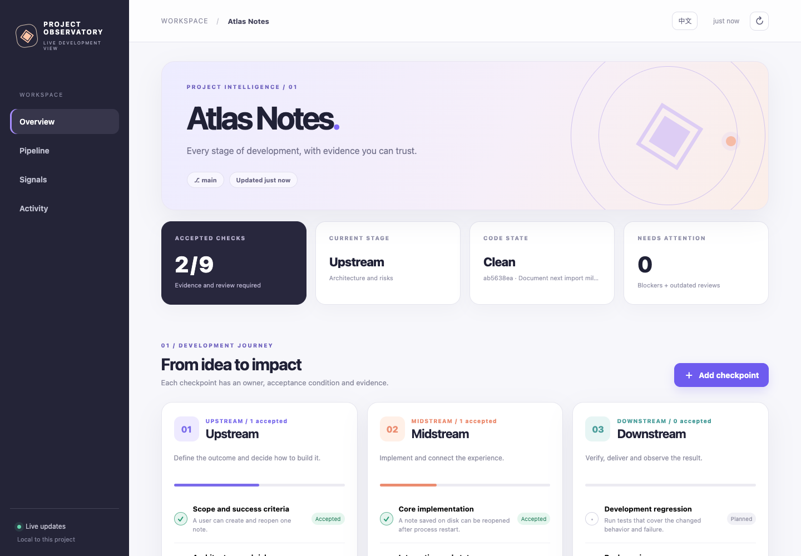

# Project Observatory · 项目全景开发面板

A beautiful, local-first development dashboard for **any repository**. It shows the full journey from goal definition through implementation, verification, delivery and operation. Each project has its own milestones and evidence. Git and optional Codex/GitHub signals refresh live; no external account or hosted service is required for the core dashboard.



## Quick start

Requires Node.js 20+ and Git. From **your own project directory**:

```bash
npx --yes github:delu543/project-observatory init --project . --lang en
npx --yes github:delu543/project-observatory serve --project .
```

Open the local URL printed in the terminal (normally `http://127.0.0.1:4187`). Use `--lang zh` for Chinese starter checkpoints. If port 4187 is occupied, run `serve --project . --port 0` for an available port.

The installer does not run your project's build, tests, model calls or deployment. `init` creates `.project-observatory/project.json` and adds `.project-observatory/` to this checkout's local Git exclude. Each checkout has its own private state. The dashboard reads only the project selected by `--project`; it cannot mix progress with another checkout. To share a plan intentionally, export and review its JSON separately.

### 中文快速开始

在**你的项目目录**运行（需要 Node.js 20+ 和 Git）：

```bash
npx --yes github:delu543/project-observatory init --project . --lang zh
npx --yes github:delu543/project-observatory serve --project .
```

打开终端显示的本机地址。首页按**上游目标与方案 → 中游开发与集成 → 下游研发验收、真实体验、交付和运行**展示检查点。点击检查点可修改要求、负责人、状态和证据，也能复制清楚的 Codex 任务要求。英语与中文可在右上角切换。

## What is live, and what is reviewed?

| Source | How it updates | What it proves |
| --- | --- | --- |
| Local Git and project structure | About every 10 seconds while the page is visible | Commit, branch, worktree change count, detected project files and available check scripts |
| GitHub (optional) | About every 60 seconds while visible | Remote commit and recent Actions runs; requires authenticated `gh` CLI |
| Codex (optional) | About every 10 seconds while visible | Tasks whose local working directory belongs to this project; uses the local Codex index if available |
| Development checkpoints | When someone edits and saves them | Explicit review with evidence; code acceptance requires a clean current commit |

**Activity never automatically becomes acceptance.** A newly changed codebase marks earlier code acceptance as “review outdated” until someone checks that version. Decision and document checkpoints retain their review. Progress is the number of reviewed checkpoints, not an estimate of hours or total effort. The starter plan begins at 0 because the tool cannot infer your acceptance criteria from filenames.

The Sources panel enables the optional Codex and GitHub adapters. Both are read only. Codex scanning is limited to the project's current working directory and bounded recent assistant messages; it does not search unrelated conversations. An integration unavailable on another machine shows its error and leaves the rest of the dashboard working. Hidden pages stop fast polling; opening the page refreshes it.

## Work with the dashboard

1. Rename the eight starter checkpoints, fill in “how will you know it works?”, and add project specific checkpoints.
2. Update a checkpoint to **In progress**, **Ready for review**, **Blocked**, or **Accepted**. Acceptance requires an evidence reference. The review is saved locally with time and commit.
3. Use **Copy Codex request** to send a scoped requirement from the project you are viewing. Copying does not send or run it.
4. Read the Signals section for current code and source status. Investigate failures or stale sources before changing the acceptance state.

The web server binds to `127.0.0.1` and protects edits with same-origin checks and a session token. Nothing is uploaded by default. The GitHub adapter reads GitHub only when enabled. The `gh` executable uses the user's own authentication; Project Observatory does not collect or store its tokens.

## Development

```bash
git clone https://github.com/delu543/project-observatory.git
cd project-observatory
npm test
node bin/project-observatory.mjs init --project /path/to/your/project --lang zh
node bin/project-observatory.mjs serve --project /path/to/your/project
```

No runtime npm dependencies. The UI uses browser APIs, the Node.js standard library and server-sent events. The optional Codex adapter uses Python 3's standard `sqlite3` in read-only mode. See [architecture and limitations](docs/ARCHITECTURE.md) and [capabilities](docs/CAPABILITY_MAP.md).

MIT licensed. The design reuses the **ideas** from a product-specific development dashboard; this repository contains no project-specific records, user stories, API keys, private task logs or fixed project paths.
